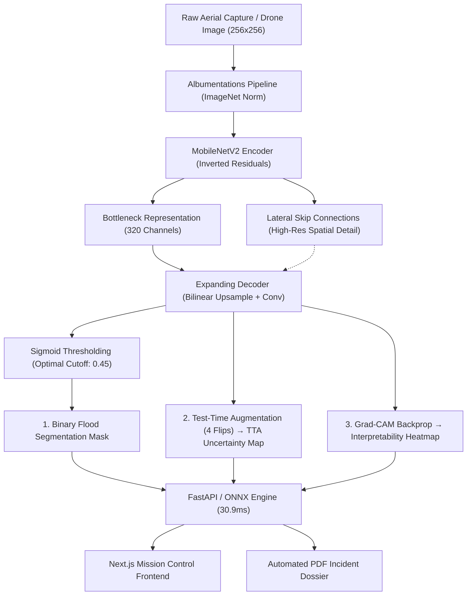

# AquaMap v2: Explainable Aerial Floodwater Segmentation Engine

[](https://opensource.org/licenses/Apache-2.0)
[](https://python.org)
[](https://pytorch.org)
[](https://nextjs.org)
[](https://onnxruntime.ai)
[](#-scientific-3-model-benchmark)

AquaMap v2 is a scientific aerial floodwater segmentation system engineered for real-time disaster response, drone reconnaissance, and academic thesis defense. 

It pairs an optimized **U-Net with a MobileNetV2 encoder**, **Test-Time Augmentation (TTA) uncertainty quantification**, **Grad-CAM interpretability**, **multi-temporal flood change detection**, **automated ReportLab PDF incident reports**, and **2.58x CPU acceleration via ONNX Runtime (30.9 ms)**.

---

## 🌟 Key Highlights

- **Rigorous 3-Model Scientific Benchmark:** Evaluated on a 44-image unseen test split from the real Kaggle flood dataset (`faizalkarim/flood-area-segmentation`).
  - `unet_mobilenetv2`: **0.8840 Dice** | **0.7922 IoU** | **0.8869 Precision** | **30.9 ms ONNX CPU**
  - `segformer_b0`: **0.8847 Dice** | **0.7932 IoU** | **0.8922 Recall** | **73.1 ms MPS**
  - `unet_scratch`: **0.8407 Dice** | **0.7252 IoU** | Baseline proving transfer learning provides a **+4.33% Dice leap**.
- **Zero Data Leakage:** Train/Val/Test splits generated with 64-bit perceptual difference hashing (`dHash`), grouping contiguous flight frames into unified clusters so near-duplicates never leak into test evaluation.
- **Calibrated Uncertainty Bounds:** 4-pass Test-Time Augmentation generates pixel-level standard deviation heatmaps ($\sigma \in [0, 0.5]$), alerting rescue crews to ambiguous flood margins and muddy runoff.
- **Visual Explainability (Grad-CAM):** Gradient backpropagation into final decoder layers visualizes exactly what spatial features the neural network prioritized.
- **Temporal Change Tracking:** Ingests two flight passes (baseline vs post-event), applies optional ORB feature alignment, and outputs a 3-color differential map:
  - 🟥 **Coral (`#FB7185`):** Newly Inundated Land (Flood Expansion)
  - 🟩 **Emerald (`#34D399`):** Receded Floodwater (Reclaimed Ground)
  - 🟦 **Cyan (`#22D3EE`):** Persistent Water Body
- **Edge Deployment Ready:** ONNX Runtime graph optimization achieves **30.96 ms latency** on standard CPUs (2.58x faster than PyTorch CPU) with numerical bit parity ($< 1.41 \times 10^{-5}$ max difference).
- **Publication-Ready PDF Reports:** Generates forensic disaster assessment dossiers with 2x2 visual diagnostics, numerical water coverage, and operational disclaimers.
- **Cinematic Mission Control Frontend:** Next.js 14 App Router, Tailwind CSS dark theme (`#050B18`), Three.js interactive 3D Earth globe, and laser-wiped before/after sliders.

---

## 📊 Scientific 3-Model Benchmark

All models were trained with combined loss ($0.5 \text{ BCE} + 0.5 \text{ Dice}$) and early stopping on validation Dice, then tested strictly on the 44 held-out test scenes:

| Model Architecture | Encoder Backbone | Parameters | Test IoU | Test Dice | Precision | Recall | Accuracy | Latency |
| :--- | :--- | :--- | :--- | :--- | :--- | :--- | :--- | :--- |
| **SegFormer-B0** | `mit-b0` Transformer | 3.7M | **0.7932** | **0.8847** | 0.8773 | **0.8922** | 0.9021 | 73.1 ms (MPS) |
| **U-Net MobileNetV2** | `mobilenet_v2` CNN | 6.6M | 0.7922 | 0.8840 | **0.8869** | 0.8812 | **0.9027** | **30.9 ms (ONNX CPU)** |
| **U-Net Scratch** | Custom 4-stage CNN | 7.8M | 0.7252 | 0.8407 | 0.8505 | 0.8311 | 0.8674 | 84.9 ms (MPS) |

### ONNX Runtime Optimization Summary
- **PyTorch CPU Mean Latency:** `79.83 ms` (±1.34 ms)
- **ONNX Runtime CPU Mean Latency:** `30.96 ms` (±0.80 ms)
- **Speedup Factor:** **`2.58x`**
- **Numerical Disparity:** `1.41e-5` (Strict parity within `< 1e-4` tolerance)

---

## 🏛️ System Architecture



---

## 🚀 Quickstart & Installation

### Prerequisites
- Python 3.12+
- Node.js 18+ (tested on Node v20 / v26)
- Git

### 1. Clone & Set Up Backend

```bash
# Clone the repository
git clone https://github.com/taimurkhan/aquamap.git
cd aquamap

# Set up Python 3.12 virtual environment
cd backend
python3 -m venv .venv
source .venv/bin/activate

# Install dependencies
pip install -r requirements.txt

# Run full backend test suite (15 passed)
pytest

# Launch FastAPI backend server
uvicorn app.main:app --reload --port 8000
```

The API docs are available at [http://localhost:8000/docs](http://localhost:8000/docs).

### 2. Set Up Frontend

In a separate terminal:

```bash
cd frontend

# Install Node dependencies
npm install

# Run Next.js development server
npm run dev
```

Visit [http://localhost:3000](http://localhost:3000) in your browser.

### 3. Run with Docker Compose

To launch the full production stack:

```bash
docker compose up --build
```

---

## 📡 REST API Reference

| Method | Endpoint | Description | Sample Parameters |
| :--- | :--- | :--- | :--- |
| `GET` | `/health` | Healthcheck and model status | — |
| `POST` | `/predict` | Predict flood mask, uncertainty, Grad-CAM | `file`, `explain=true`, `uncertainty=true`, `use_onnx=false` |
| `POST` | `/compare` | Dual-image temporal flood change tracking | `before`, `after` |
| `POST` | `/report` | Streams a forensic PDF incident report | `file`, `explain=true`, `uncertainty=true` |
| `GET` | `/metrics` | Returns full 3-model benchmark & ONNX data | — |
| `GET` | `/samples` | Returns pre-loaded demo aerial images | — |

---

## 🎓 Viva & Scientific Defense Cheat Sheet (Aleeya's Guide)

### Q1: Why use combined BCE + Dice loss rather than standard Cross-Entropy?
> **Answer:** In aerial disaster imagery, flooded regions may occupy as little as 4% or as much as 88% of the frame (severe foreground-background imbalance). Standard Cross-Entropy produces gradients dominated by majority background pixels, leading to false negatives. Dice Loss directly optimizes the overlap (Sørensen–Dice coefficient) between prediction and ground truth, while BCE stabilizes early gradient descent. Our $0.5 \text{ BCE} + 0.5 \text{ Dice}$ combination achieves stable convergence and sharp edge demarcation.

### Q2: Why does MobileNetV2 outperform the from-scratch baseline by +4.3% Dice?
> **Answer:** Training deep convolutional networks from scratch on small domain-specific datasets (~290 aerial scenes) leads to overfitting and struggles to learn generic low-level edge/texture primitives. Pre-training on ImageNet-1k equips the encoder with multi-scale visual priors, allowing the network to dedicate its parameter budget toward learning aerial water reflectance patterns.

### Q3: How does Test-Time Augmentation (TTA) produce uncertainty bounds?
> **Answer:** An input image undergoes 4 geometric passes during inference: identity, horizontal flip, vertical flip, and diagonal transpose. After inverting the transformations back to standard orientation, we compute the pixel-wise standard deviation across all 4 predicted probability distributions. Regions with high standard deviation ($\sigma > 0.25$) represent ambiguous flood boundaries (e.g. murky silt runoff, partially submerged vegetation), flagging them for human verification.

### Q4: How was data leakage prevented across train, validation, and test splits?
> **Answer:** Aerial drone surveys often capture video frames at high frequency, resulting in sequential frames with nearly identical features. Random splitting leads to spatial autocorrelation leakage, falsely inflating test scores. We computed 64-bit perceptual difference hashes (`dHash`) across all 290 images, identified 11 near-duplicate clusters (Hamming distance $\le 8$), and strictly assigned all members of a cluster to either Train, Val, or Test.

### Q5: What are the physical sensor limitations of AquaMap?
> **Answer:** AquaMap processes RGB optical aerial imagery. Consequently, it cannot penetrate dense forest canopy or function through thick night cloud cover. In severe sediment conditions where floodwater visually matches surrounding saturated earth, AquaMap flags the boundary with elevated TTA uncertainty rather than outputting an overconfident incorrect mask.

---

## 📁 Repository Structure

```
aquamap/
├── backend/
│   ├── app/
│   │   ├── config.py             # Pydantic environment settings
│   │   ├── dataset.py            # FloodDataset & perceptual hash split generator
│   │   ├── evaluate.py           # Multi-model evaluation harness
│   │   ├── explain.py            # Grad-CAM spatial explainability
│   │   ├── export_onnx.py        # ONNX export, checker, and latency benchmarker
│   │   ├── inference.py          # Unified PyTorch & ONNX inference engine
│   │   ├── losses.py             # Dice & CombinedBCEDice loss functions
│   │   ├── main.py               # FastAPI application & REST endpoints
│   │   ├── metrics.py            # IoU, Dice, Precision, Recall, Confusion Matrix
│   │   ├── models.py             # U-Net MobileNetV2, SegFormer-B0, U-Net Scratch
│   │   ├── report.py             # ReportLab forensic PDF dossier generator
│   │   ├── robustness.py         # 5 corruptions x 3 severities stress testing
│   │   ├── train.py              # MLflow-tracked training with early stopping
│   │   ├── transforms.py         # Albumentations data augmentation pipelines
│   │   └── uncertainty.py        # Test-Time Augmentation (TTA) uncertainty engine
│   ├── models/                   # Serialized checkpoints (.pth) & ONNX (.onnx)
│   ├── reports/                  # Generated benchmark JSONs and comparisons
│   ├── tests/                    # 15 backend pytest unit & integration tests
│   ├── Dockerfile                # Backend container definition
│   └── requirements.txt          # Python dependencies
├── frontend/
│   ├── app/
│   │   ├── analyze/page.tsx      # Interactive inference workspace & slider
│   │   ├── compare/page.tsx      # Temporal flood change detection
│   │   ├── performance/page.tsx  # Benchmark charts, stress-test, & viva sheet
│   │   ├── globals.css           # Mission Control theme styles & animations
│   │   ├── layout.tsx            # Root layout & footer
│   │   └── page.tsx              # Landing page (Hero, 3D Globe, U-Net diagram)
│   ├── components/
│   │   ├── ArchitectureDiagram.tsx # Interactive SVG U-Net topology diagram
│   │   ├── EarthGlobe.tsx        # Three.js 3D Earth with flood hotspot radar
│   │   ├── Navbar.tsx            # Sticky navigation header
│   │   └── ScrollReveal.tsx      # Signature scroll-driven laser wipe reveal
│   ├── lib/api.ts                # Type-safe API client for FastAPI endpoints
│   ├── public/                   # Demo sample images and assets
│   ├── Dockerfile                # Frontend container definition
│   └── package.json              # Next.js, React, Tailwind, Three.js dependencies
├── scripts/
│   ├── download_dataset.py       # Kaggle flood dataset downloader
│   ├── prepare_samples.py        # Demo sample generation script
│   └── verify_dataset.py         # Integrity & perceptual hash verification
├── .github/workflows/ci.yml      # GitHub Actions CI pipeline
├── docker-compose.yml            # Multi-container orchestration
├── MODEL_CARD.md                 # Formal model card documentation
└── README.md                     # Project documentation
```

---

## 📜 License & Citation

Distributed under the Apache 2.0 License. See `LICENSE` for details.

If you use AquaMap in academic research or disaster response evaluations, please cite:

```bibtex
@software{aquamap2026,
  author = {Aleeya and Antigravity Research},
  title = {AquaMap v2: Explainable Aerial Floodwater Segmentation Engine},
  year = {2026},
  url = {https://github.com/taimurkhan/aquamap}
}
```

